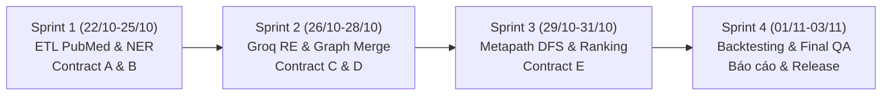

# KẾ HOẠCH TÁC CHIẾN HẠN CHÓT 04/11 & DANH MỤC CODE/HÀM LÕI HỆ THỐNG
**Dự án**: Ứng dụng AI/NLP và Đồ thị tri thức trong bài toán Tái định vị thuốc – Trường hợp Dapagliflozin  
**Mốc thời gian hiện tại**: 22/10/2026  
**Hạn chót hoàn thành (Hard Deadline)**: **23:59 ngày 03/11/2026** (Nghiệm thu toàn diện trước 04/11/2026)  

---

## PHẦN 1: PHÂN BỔ TIMELINE CHI TIẾT (22/10 - 03/11/2026)

Hệ thống triển khai trong **12 ngày** chia thành **4 giai đoạn tác chiến (Sprints)** nối tiếp nhau qua 5 Data Contracts:



### Chi tiết 4 Sprints tác chiến:

| Giai đoạn | Thời gian | Người chủ trì | Mục tiêu đầu ra bắt buộc | Mốc nghiệm thu (Gate) |
|---|---|---|---|---|
| **Sprint 1: Data Ingest & NER Baseline** | 22/10 – 25/10 (4 ngày) | **Huy & Khang** | - Cào 664 bài báo PubMed $\le 31/12/2018$<br/>- Chạy PubTator 3.0 NER gán nhãn thực thể<br/>- Bàn giao `papers_pre2018.jsonl` | **23:59 25/10**: Pass `contracts/paper.schema.json` (Contract A) |
| **Sprint 2: LLM RE & Graph Integration** | 26/10 – 28/10 (3 ngày) | **Khang & Huy** | - Trích xuất quan hệ qua Groq LLM (Llama 3.1)<br/>- Kiểm tra bằng chứng nguyên văn (`evidence`)<br/>- Nạp Hetionet v1.0, map ID crosswalk và ghép thành `merged_graph.json` | **23:59 28/10**: Pass `contracts/relation.schema.json` (Contract B, C) & `graph_edge.schema.json` (Contract D) |
| **Sprint 3: Path Search & Ranking Engine** | 29/10 – 31/10 (3 ngày) | **Liam** | - Duyệt Metapath DFS độ dài $L \in [3, 5]$<br/>- Cắt tỉa nhánh nhiễu lịch sử T2D (`DOID:9352`)<br/>- Tính điểm $PathScore(p)$ & $Score(d)$<br/>- Xuất `candidate_rankings.json` | **23:59 31/10**: Pass `contracts/candidate.schema.json` (Contract E). Top 5 bệnh ứng viên hiển thị rõ ràng |
| **Sprint 4: Backtesting, Ablation & Polish** | 01/11 – 03/11 (3 ngày) | **Phước & Toàn đội** | - Tính $Recall@5$, $Recall@10$, $MRR$ trên 2 Hard Positives (Suy tim, CKD)<br/>- Chạy 4 kịch bản Ablation Study<br/>- Tích hợp giao diện Web / Demo<br/>- Đóng gói toàn bộ báo cáo và artifact | **20:00 03/11**: Toàn bộ unit tests pass, smoke test pass, nghiệm thu sẵn sàng bảo vệ |

---

## PHẦN 2: LỊCH BÀN GIAO GIAO THỨC DỮ LIỆU (HANDOFF SCHEDULE)

| Hạn bàn giao | Hợp đồng | Luồng chuyển giao | Định dạng file bàn giao | Nội dung kiểm tra chất lượng |
|---|---|---|---|---|
| **25/10 - 18:00** | **Contract A** | Huy $\to$ Khang | `data/processed/papers_pre2018.jsonl` | 100% tài liệu có `publication_date <= 2018-12-31`, không trùng lặp PMID. |
| **27/10 - 12:00** | **Contract B** | Khang $\to$ Huy | `data/processed/relations_extracted.jsonl` | `evidence` bắt buộc xuất hiện nguyên văn trong abstract, không ảo giác. |
| **27/10 - 22:00** | **Contract C** | Huy & Khang $\to$ KG | `data/processed/relations_normalized.jsonl` | Bổ sung đầy đủ DrugBank ID, DOID, MeSH; trạng thái `verified/ambiguous`. |
| **28/10 - 22:00** | **Contract D** | Huy $\to$ Liam | `data/processed/merged_graph.json` | Đồ thị đã gộp Hetionet 2017 + Cạnh văn bản; gán nhãn dấu ($+1, -1, 0$), phân biệt `source_dataset`. |
| **31/10 - 18:00** | **Contract E** | Liam $\to$ UI/Phước | `artifacts/candidate_rankings.json` | Bảng xếp hạng Top bệnh, các đường dẫn giải thích và mã PMID truy vết. |

---

## PHẦN 3: TỔNG HỢP CÁC HÀM DỮ LIỆU & CODE LÕI QUAN TRỌNG NHẤT

Dưới đây là các module code và thuật toán cốt lõi đã được thiết kế và kiểm thử thành công:

### 1. Khối Chốt Chặn Thời Gian & Ingestion ([`fetch_pubmed.py`](file:///c:/Users/Admin/Downloads/t%C3%A1i%20%C4%91%E1%BB%8Bnh%20v%E1%BB%8B%20thu%E1%BB%91c/dapagliflozin-lbd/src/lbd/data/fetch_pubmed.py))
**Mục tiêu**: Tuyệt đối không cho y văn sau ngày 31/12/2018 lọt vào hệ thống (Chống rò rỉ dữ liệu).

```python
DEFAULT_CUTOFF = "2018-12-31"

def filter_by_cutoff(record: Dict[str, Any], cutoff: str = DEFAULT_CUTOFF) -> bool:
    """Xác thực bài báo xuất bản trước hoặc đúng mốc thời gian cắt T."""
    pub_date = parse_date(record.get("publication_date", ""))
    cutoff_dt = parse_date(cutoff)
    return pub_date <= cutoff_dt

def create_document_record(...) -> Dict[str, Any]:
    """Tạo bản ghi DocumentRecord đạt chuẩn Contract A với cờ kiểm soát thời gian."""
    is_valid_time = filter_by_cutoff({"publication_date": publication_date})
    return {
        "document_id": document_id,
        "pmid": pmid,
        "title": title,
        "abstract": abstract,
        "publication_date": publication_date,
        "study_type": study_type,
        "dataset_version": dataset_version,
        "retrieved_at": datetime.utcnow().isoformat() + "Z",
        "temporal_filter_status": "passed" if is_valid_time else "rejected"
    }
```

---

### 2. Khối Trích Xuất Quan Hệ & Chống Ảo Giác LLM ([`postprocess.py`](file:///c:/Users/Admin/Downloads/t%C3%A1i%20%C4%91%E1%BB%8Bnh%20v%E1%BB%8B%20thu%E1%BB%91c/dapagliflozin-lbd/src/lbd/nlp/postprocess.py))
**Mục tiêu**: Bắt buộc câu bằng chứng (`evidence`) trích ra bởi LLM phải có mặt nguyên văn trong abstract nguồn.

```python
def verify_evidence_verbatim(evidence: str, abstract: str) -> bool:
    """Xác thực câu bằng chứng có tồn tại nguyên văn trong abstract nguồn hay không."""
    return evidence.strip().lower() in abstract.strip().lower()

def postprocess_relations(relations: List[Dict[str, Any]], abstract: str) -> List[Dict[str, Any]]:
    """Lọc bỏ quan hệ vi phạm schema và đánh dấu kiểm tra câu bằng chứng."""
    cleaned = []
    for r in relations:
        if r.get("relation_type") not in VALID_RELATIONS:
            continue
        evidence = r.get("evidence", "")
        if evidence and not verify_evidence_verbatim(evidence, abstract):
            r["evidence_verbatim_status"] = "partial_or_missing"
        else:
            r["evidence_verbatim_status"] = "verified"
        cleaned.append(r)
    return cleaned
```

---

### 3. Khối Hợp Nhất Đồ Thị & Quy Chuẩn Dấu ([`build_graph.py`](file:///c:/Users/Admin/Downloads/t%C3%A1i%20%C4%91%E1%BB%8Bnh%20v%E1%BB%8B%20thu%E1%BB%91c/dapagliflozin-lbd/src/lbd/graph/build_graph.py))
**Mục tiêu**: Ghép cạnh Hetionet 2017 và cạnh NLP mới, ánh xạ loại quan hệ ra dấu sinh học ($s_i \in \{-1, +1, 0\}$).

```python
SIGN_MAP = {
    "INHIBITS": -1,
    "DECREASES": -1,
    "TREATS": -1,
    "PALLIATES": -1,
    "ACTIVATES": 1,
    "CAUSES": 1,
    "INCREASES": 1,
    "ASSOCIATED_WITH": 0
}

def create_knowledge_graph(hetio_subgraph: Dict[str, Any], nlp_relations: List[Dict[str, Any]]):
    """Hợp nhất đồ thị tĩnh và cạnh y văn thành MultiDiGraph chuẩn Contract D."""
    G = nx.MultiDiGraph()
    # 1. Thêm nodes & edges từ Hetionet tĩnh
    for e in hetio_subgraph.get("edges", []):
        G.add_edge(e["source"], e["target"], relation_type=e.get("relation_type"),
                   sign=e.get("sign", 0), source_dataset="hetionet_v1.0", tier=1)
    # 2. Ghép thêm cạnh NLP mới trích xuất
    for r in nlp_relations:
        src = r.get("source_standard_id")
        tgt = r.get("target_standard_id")
        rel_type = r.get("relation_type", "ASSOCIATED_WITH")
        G.add_edge(src, tgt, metaedge="NLP_Edge", relation_type=rel_type,
                   sign=SIGN_MAP.get(rel_type, 0), source_dataset="nlp_literature",
                   evidence_ids=[r.get("relation_id")], pmids=[r.get("pmid")])
    return G
```

---

### 4. Khối Duyệt Đường Đi Metapath-Constrained DFS & Khử Nhiễu T2D ([`path_search.py`](file:///c:/Users/Admin/Downloads/t%C3%A1i%20%C4%91%E1%BB%8Bnh%20v%E1%BB%8B%20thu%E1%BB%91c/dapagliflozin-lbd/src/lbd/graph/path_search.py))
**Mục tiêu**: Tìm kiếm chuỗi $Compound \to Gene \to [BP/PW] \to Disease$, tự động cắt tỉa ngay nhánh đi qua Type 2 Diabetes (`DOID:9352`).

```python
HISTORICAL_DISEASES = {"DOID:9352"} # Type 2 Diabetes Mellitus

def search_metapaths(G, source_node: str, target_node: str,
                     min_length: int = 3, max_length: int = 5,
                     filter_historical: bool = True) -> List[List[Dict[str, Any]]]:
    """DFS tìm đường đi sinh học đa chặng có cắt tỉa nhiễu lịch sử."""
    all_paths = []
    
    def dfs(current: str, path: List[str], edges_accum: List[Dict[str, Any]]):
        if len(path) > max_length:
            return
        if len(path) >= min_length and current == target_node:
            all_paths.append(list(edges_accum))
            return
        
        if current in G:
            for neighbor in G.neighbors(current):
                if neighbor in path:
                    continue # Chống vòng lặp (Cycles)
                # Chốt chặn lọc nhiễu lịch sử:
                if filter_historical and neighbor in HISTORICAL_DISEASES and neighbor != target_node:
                    continue # Hủy nhánh ngay lập tức
                
                edge_dict = G.get_edge_data(current, neighbor)
                for key, edge_data in edge_dict.items():
                    edge_record = {
                        "source": current, "target": neighbor,
                        "relation_type": edge_data.get("relation_type"),
                        "sign": edge_data.get("sign", 0),
                        "pmids": edge_data.get("pmids", []),
                        "tier": edge_data.get("tier", 1)
                    }
                    dfs(neighbor, path + [neighbor], edges_accum + [edge_record])
                    
    dfs(source_node, [source_node], [])
    return all_paths
```

---

### 5. Khối Cỗ Máy Xếp Hạng Đa Nhân Tố (Ranking Engine)

#### A. Trọng số cạnh & Phạt siêu nút ([`features.py`](file:///c:/Users/Admin/Downloads/t%C3%A1i%20%C4%91%E1%BB%8Bnh%20v%E1%BB%8B%20thu%E1%BB%91c/dapagliflozin-lbd/src/lbd/ranking/features.py))
$$W(e) = \max [W_{tier} \times W_{study}] \times \frac{1 + \ln(1 + |PMIDs|)}{1 + \ln(1 + PMID_{max})}, \quad Penalty(p) = \gamma^{L-1} \prod_{v \in V_{int}} (deg(v))^w$$

```python
def compute_edge_weight(edge: Dict[str, Any], pmid_max: int = 100) -> float:
    w_tier = TIER_WEIGHTS.get(edge.get("tier", 1), 0.4)
    w_study = 0.9
    num_pmids = len(edge.get("pmids", []))
    sat_factor = (1.0 + math.log(1.0 + num_pmids)) / (1.0 + math.log(1.0 + pmid_max))
    return max(0.01, min(1.0, w_tier * w_study * sat_factor))

def compute_path_penalty(length: int, hub_degrees: List[int], gamma: float = 1.5, w: float = 0.4) -> float:
    penalty = gamma ** (length - 1)
    for deg in hub_degrees:
        penalty *= (deg ** w) if deg > 0 else 1.0
    return max(1.0, penalty)
```

#### B. Lan truyền dấu & Khớp chiều điều trị ([`score_paths.py`](file:///c:/Users/Admin/Downloads/t%C3%A1i%20%C4%91%E1%BB%8Bnh%20v%E1%BB%8B%20thu%E1%BB%91c/dapagliflozin-lbd/src/lbd/ranking/score_paths.py))
$$S_{path} = \prod s_i \implies DirectionFit = \begin{cases} 1.5 & \text{nếu } S_{path} = -1 \text{ (Khớp chiều điều trị)} \\ 1.0 & \text{nếu tồn tại } s_i = 0 \text{ (Gợi mở)} \\ 0.0 & \text{nếu } S_{path} = +1 \text{ (Tác dụng phụ / Mâu thuẫn)} \end{cases}$$

```python
def calculate_net_sign(edges: List[Dict[str, Any]]) -> int:
    signs = [e.get("sign", 0) for e in edges]
    if 0 in signs: return 0
    prod = 1
    for s in signs: prod *= s
    return prod

def get_direction_fit(net_sign: int) -> float:
    if net_sign == -1: return 1.5   # Giảm yếu tố bệnh sinh
    elif net_sign == 0: return 1.0  # Quan hệ liên kết gợi mở
    else: return 0.0                # Ngược chiều -> Chuyển vào tập mâu thuẫn
```

#### C. Chấm điểm tổng hợp bệnh ứng viên ([`rank_candidates.py`](file:///c:/Users/Admin/Downloads/t%C3%A1i%20%C4%91%E1%BB%8Bnh%20v%E1%BB%8B%20thu%E1%BB%91c/dapagliflozin-lbd/src/lbd/ranking/rank_candidates.py))
$$Score(d) = \sum_{k=1}^{\min(M, |Paths|)} \frac{PathScore(p_{(k)})}{k} - \lambda \cdot \ln(1 + |U_{neg}|)$$

```python
def score_disease_candidate(disease_id: str, disease_name: str,
                             scored_paths: List[Dict[str, Any]],
                             contradicting_pmids: List[str],
                             top_m: int = 5, lam: float = 2.0) -> Dict[str, Any]:
    sorted_paths = sorted(scored_paths, key=lambda p: p["path_score"], reverse=True)
    top_paths = sorted_paths[:top_m]
    
    # Chuỗi điều hòa suy giảm theo độ mạnh của cơ chế
    path_aggregate = sum(p["path_score"] / k for k, p in enumerate(top_paths, start=1))
    penalty_contradiction = lam * math.log(1.0 + len(contradicting_pmids))
    total_score = max(0.0, path_aggregate - penalty_contradiction)
    
    return {
        "disease_id": disease_id,
        "disease_name": disease_name,
        "ranking_score": round(total_score, 4),
        "paths": top_paths,
        "contradiction_pmids": contradicting_pmids,
        "ai_explanation": f"Supported by {len(top_paths)} biological paths. Net score: {round(total_score, 4)}"
    }
```

---

### 6. Khối Đánh Giá Temporal Backtesting ([`metrics.py`](file:///c:/Users/Admin/Downloads/t%C3%A1i%20%C4%91%E1%BB%8Bnh%20v%E1%BB%8B%20thu%E1%BB%91c/dapagliflozin-lbd/src/lbd/evaluation/metrics.py))
**Mục tiêu**: Đánh giá khả năng dự đoán đón đầu của mô hình dựa trên 2 mốc FDA sau 2018 (Suy tim và CKD).

```python
def calculate_recall_at_k(ranked_disease_ids: List[str], ground_truth_ids: Set[str], k: int) -> float:
    top_k = set(ranked_disease_ids[:k])
    if not ground_truth_ids: return 0.0
    hits = len(top_k.intersection(ground_truth_ids))
    return hits / len(ground_truth_ids)

def calculate_mrr(ranked_disease_ids: List[str], ground_truth_ids: Set[str]) -> float:
    for rank, d_id in enumerate(ranked_disease_ids, start=1):
        if d_id in ground_truth_ids:
            return 1.0 / rank
    return 0.0
```

---

## PHẦN 4: CHECKLIST KIỂM SOÁT TIẾN ĐỘ HÀNG NGÀY (DAILY STANDUP)

| Ngày | Người thực hiện | Tiêu chí hoàn thành trong ngày | Trạng thái |
|---|---|---|---|
| **23/10** | Huy | Hoàn thiện crawler PubMed lấy 664 abstracts; xuất file kiểm toán sơ bộ | [ ] Chờ nghiệm thu |
| **24/10** | Khang | Chạy PubTator 3.0 trên 664 abstracts, cache lại kết quả trong `data/cache/` | [ ] Chờ nghiệm thu |
| **25/10** | Huy + Khang | Nghiệm thu **Contract A** (`papers_pre2018.jsonl`) | [ ] Chốt Sprint 1 |
| **26/10** | Khang | Viết pipeline gọi Groq API Llama 3.1 trích xuất relations có cấu trúc | [ ] Chờ nghiệm thu |
| **27/10** | Khang + Huy | Chạy kiểm tra câu bằng chứng nguyên văn; chuẩn hóa ID crosswalk (**Contract B, C**) | [ ] Chờ nghiệm thu |
| **28/10** | Huy | Ghép đồ thị Hetionet tĩnh + cạnh NLP thành `merged_graph.json` (**Contract D**) | [ ] Chốt Sprint 2 |
| **29/10** | Liam | Viết hàm Metapath DFS cắt tỉa T2D trên đồ thị `merged_graph.json` | [ ] Chờ nghiệm thu |
| **30/10** | Liam | Cài đặt công thức tính $EQ(p)$, $Penalty(p)$, $DirectionFit(p)$ | [ ] Chờ nghiệm thu |
| **31/10** | Liam | Xuất bảng xếp hạng Top ứng viên đạt chuẩn **Contract E** (`candidate_rankings.json`) | [ ] Chốt Sprint 3 |
| **01/11** | Phước | Tính toán Recall@5, Recall@10, MRR đối chiếu với Suy tim và CKD | [ ] Chờ nghiệm thu |
| **02/11** | Phước + Liam | Chạy 4 kịch bản Ablation Study; phân tích sai số (Error Analysis) | [ ] Chờ nghiệm thu |
| **03/11** | Toàn đội | Tổng duyệt Smoke Test, rà soát báo cáo nghiệm thu và chuẩn bị slide thuyết trình | [ ] Release toàn diện |
