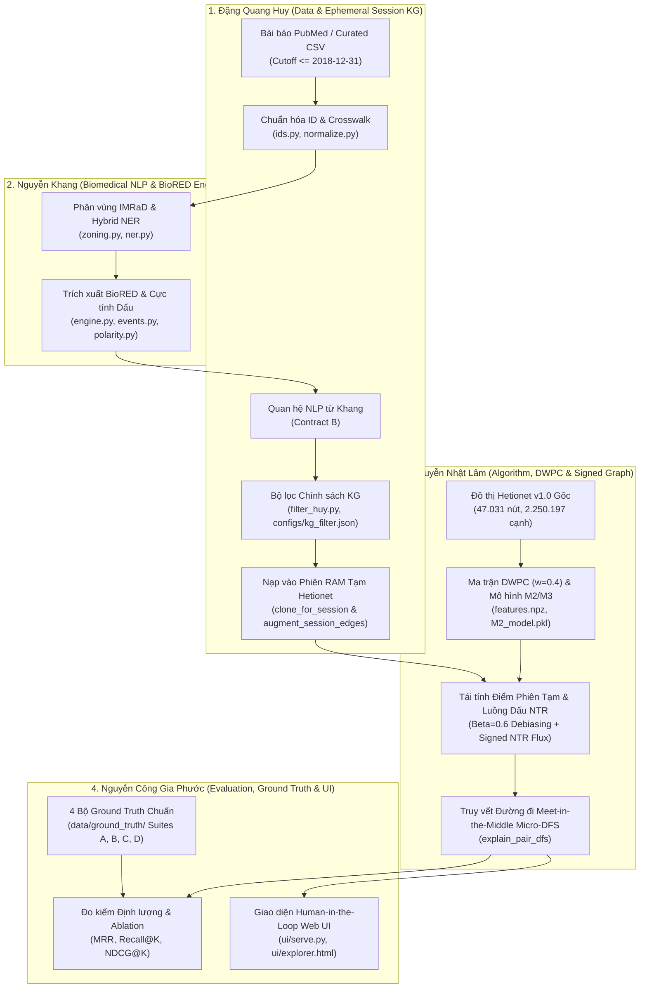

# Tài liệu Thiết kế Hệ thống & Phân công Chi tiết 4 Thành viên (Team Design Guide v3.0)

Tài liệu này quy định kiến trúc kỹ thuật, hợp đồng dữ liệu (Data Contracts A–E), mô hình huấn luyện (`M0`, `M2`, `M3`), các bộ dữ liệu kiểm định chuẩn (Ground Truth Suites A–D), và trách nhiệm cụ thể của từng thành viên trong nhóm.

---

## 1. Sơ đồ Kiến trúc Tổng thể & Luồng Dữ liệu (End-to-End Architecture)

---

## 2. Chi tiết Trách nhiệm & Cấu trúc File của 4 Thành viên

### 2.1. Thành viên 1: Đặng Quang Huy — Data Engineering, Bộ lọc KG & Nạp Session Tạm
- **Mục tiêu cốt lõi:** Đảm bảo nguồn dữ liệu bài báo sạch, đúng chuẩn định danh Hetionet v1.0, không rò rỉ tương lai (`publication_date <= 2018-12-31`), lọc bỏ các câu giả thuyết/phủ định, và nạp các cạnh đạt chuẩn vào phiên RAM tạm thời của đồ thị Hetionet mà **không bao giờ ghi đè lên tệp đồ thị gốc trên ổ cứng (Zero Disk Mutation)**.
- **Danh sách tệp quản lý:**
  1. [`src/lbd/common/ids.py`](file:///c:/Users/Admin/Downloads/tái%20định%20vị%20thuốc/dapagliflozin-lbd/src/lbd/common/ids.py): Từ điển `ID_CROSSWALK` ánh xạ tên thuốc/gen/bệnh sang mã chuẩn DrugBank (`DBxxxxx`), NCBI Entrez Gene ID, và Disease Ontology (`DOID:xxxx`).
  2. [`src/lbd/data/normalize.py`](file:///c:/Users/Admin/Downloads/tái%20định%20vị%20thuốc/dapagliflozin-lbd/src/lbd/data/normalize.py): Hàm `normalize_entity_name` và `normalize_relation_record`.
  3. [`src/lbd/data/fetch_pubmed.py`](file:///c:/Users/Admin/Downloads/tái%20định%20vị%20thuốc/dapagliflozin-lbd/src/lbd/data/fetch_pubmed.py) & [`scripts/collect_multidrug_abstracts.py`](file:///c:/Users/Admin/Downloads/tái%20định%20vị%20thuốc/dapagliflozin-lbd/scripts/collect_multidrug_abstracts.py): Công cụ thu thập bài báo từ NCBI E-utilities có kiểm soát mốc thời gian.
  4. [`scripts/filter_huy.py`](file:///c:/Users/Admin/Downloads/tái%20định%20vị%20thuốc/dapagliflozin-lbd/scripts/filter_huy.py) & [`configs/kg_filter.json`](file:///c:/Users/Admin/Downloads/tái%20định%20vị%20thuốc/dapagliflozin-lbd/configs/kg_filter.json): Bộ lọc chính sách kiểm tra 4 điều kiện:
     - `confidence_score >= 0.70`
     - `assertion_status == "asserted"` (loại bỏ `hypothetical`, `negated`)
     - `section_zone in {"RESULTS", "CONCLUSION", "TITLE", "METHODS"}` (chặn `INTRODUCTION`/`BACKGROUND` đơn thuần)
     - `publication_date <= 2018-12-31`
  5. [`src/lbd/graph/build_graph.py`](file:///c:/Users/Admin/Downloads/tái%20định%20vị%20thuốc/dapagliflozin-lbd/src/lbd/graph/build_graph.py) & các phương thức `clone_for_session()`, `augment_session_edges()` trong [`src/lbd/ranking/m2_ranker.py`](file:///c:/Users/Admin/Downloads/tái%20định%20vị%20thuốc/dapagliflozin-lbd/src/lbd/ranking/m2_ranker.py#L532-L645).

---

### 2.2. Thành viên 2: Nguyễn Khang — Biomedical NLP, BioRED Engine & Verbatim Grounding
- **Mục tiêu cốt lõi:** Chuyển đổi văn bản phi cấu trúc từ bài báo y sinh thành các bản ghi quan hệ có định hướng và dấu sinh học (`sign` $\in \{-1, 0, +1\}$) tuân thủ nghiêm ngặt **Contract B** (`extracted_relation.schema.json`).
- **Danh sách tệp quản lý:**
  1. [`src/lbd/nlp/engine.py`](file:///c:/Users/Admin/Downloads/tái%20định%20vị%20thuốc/dapagliflozin-lbd/src/lbd/nlp/engine.py): Lớp điều phối chính `NLPEngine` nối toàn bộ 4 tầng xử lý NLP.
  2. [`src/lbd/nlp/zoning.py`](file:///c:/Users/Admin/Downloads/tái%20định%20vị%20thuốc/dapagliflozin-lbd/src/lbd/nlp/zoning.py) & [`src/lbd/nlp/sentence_splitter.py`](file:///c:/Users/Admin/Downloads/tái%20định%20vị%20thuốc/dapagliflozin-lbd/src/lbd/nlp/sentence_splitter.py): Tách câu y sinh (bảo toàn viết tắt `Dr.`, `fig.`, `p < 0.05`) và gán nhãn vùng IMRaD (`BACKGROUND`, `METHODS`, `RESULTS`, `CONCLUSION`).
  3. [`src/lbd/nlp/ner.py`](file:///c:/Users/Admin/Downloads/tái%20định%20vị%20thuốc/dapagliflozin-lbd/src/lbd/nlp/ner.py) & [`src/lbd/nlp/external_annotations.py`](file:///c:/Users/Admin/Downloads/tái%20định%20vị%20thuốc/dapagliflozin-lbd/src/lbd/nlp/external_annotations.py): Nhận diện thực thể lai kết hợp PubTator 3.0 API và từ điển regex tốc độ cao `LOCAL_KEYWORD_MAP`.
  4. [`src/lbd/nlp/classifier.py`](file:///c:/Users/Admin/Downloads/tái%20định%20vị%20thuốc/dapagliflozin-lbd/src/lbd/nlp/classifier.py), [`src/lbd/nlp/events.py`](file:///c:/Users/Admin/Downloads/tái%20định%20vị%20thuốc/dapagliflozin-lbd/src/lbd/nlp/events.py), [`src/lbd/nlp/polarity.py`](file:///c:/Users/Admin/Downloads/tái%20định%20vị%20thuốc/dapagliflozin-lbd/src/lbd/nlp/polarity.py), [`src/lbd/nlp/fusion.py`](file:///c:/Users/Admin/Downloads/tái%20định%20vị%20thuốc/dapagliflozin-lbd/src/lbd/nlp/fusion.py): Trích xuất sự kiện dựa trên checkpoint [`model_v3_biored_multiclass.pkl`](file:///c:/Users/Admin/Downloads/tái%20định%20vị%20thuốc/dapagliflozin-lbd/src/lbd/nlp/model_v3_biored_multiclass.pkl) và tính toán dấu sinh học (`INHIBITS`/`DECREASES` $\rightarrow -1$, `ACTIVATES`/`INCREASES` $\rightarrow +1$).

---

### 2.3. Thành viên 3: Nguyễn Nhật Lâm — Thuật toán Xếp hạng DWPC, Khử thiên lệch ($\beta=0.6$) & Signed Graph NTR
- **Mục tiêu cốt lõi:** Xếp hạng 137 bệnh trong Hetionet cho bất kỳ hoạt chất nào với độ chính xác cao trên cả bệnh phổ biến lẫn bệnh hiếm, đồng thời giải thích cơ chế sinh học bằng các đường đi cụ thể có gắn dấu.
- **Bốn trụ cột toán học trong [`src/lbd/ranking/m2_ranker.py`](file:///c:/Users/Admin/Downloads/tái%20định%20vị%20thuốc/dapagliflozin-lbd/src/lbd/ranking/m2_ranker.py):**
  1. **Biểu diễn Topo Vĩ mô (DWPC Macro-Matrix, $w=0.4$):**
     $$\text{DWPC}(c, d, m) = \sum_{p \in P_m(c, d)} \prod_{v \in p} \text{deg}(v)^{-0.4}$$
     Biến đổi qua $\text{arcsinh}(x / \mu_m)$ và chuẩn hóa Z-score, đưa vào mô hình Logistic Regression chính quy hóa L2 (`M2_model.pkl`).
  2. **Khử thiên lệch bậc theo từng thuốc (Compound-Degree Debiasing, $\beta = 0.6$):**
     $$S_{\text{debiased}}(c, d) = \frac{P_{M2}(c, d)}{\left(P_{\text{prior}}(d)\right)^{\beta}}, \quad \beta = 0.6$$
     Giúp triệt tiêu hiện tượng các nút bệnh siêu kết nối (Ung thư, Tăng huyết áp) độc chiếm Top 10, giúp **Recall@10 tăng gấp 3 lần** và nhạy bén với các bệnh hiếm.
  3. **Đồ thị Có dấu — Tỷ lệ Thuận lợi Điều trị Ròng (Signed Graph Net Therapeutic Ratio — NTR Flux):**
     $$\text{NTR}(c, d) = \frac{\Phi_{\text{rev}}(c, d) - \Phi_{\text{cong}}(c, d)}{\Phi_{\text{rev}}(c, d) + \Phi_{\text{cong}}(c, d) + 1.0} \in [-1, +1]$$
     Trong đó $\Phi_{\text{rev}}$ tổng hợp các metapath đảo ngược bệnh sinh (`CdG..DuG`, `CuG..DdG`, và L1000 transcriptional reversal, tích dấu $= -1$), còn $\Phi_{\text{cong}}$ tổng hợp các metapath thuận chiều bệnh sinh (`CdG..DdG`, `CuG..DuG`, tích dấu $= +1$).
  4. **Truy vết Đường đi Vi mô (Meet-in-the-Middle Micro-DFS — `explain_pair_dfs`):**
     Duyệt hai chiều từ Thuốc ($C \rightarrow G$) và từ Bệnh ($D \leftarrow G$) để tìm tất cả đường đi 3 nút ($C-G-D$) và 5 nút ($C-G-X-G-D$), xếp hạng theo đóng góp log-odds thực tế và gắn nhãn `mechanism_type` $\in \{\text{therapeutic}, \text{pathogenic}, \text{neutral}\}$.

---

### 2.4. Thành viên 4: Nguyễn Công Gia Phước — Kiểm định (Evaluation), Ground Truth & Human-in-the-Loop UI
- **Mục tiêu cốt lõi:** Quản lý toàn bộ dữ liệu chuẩn đối chiếu (`data/ground_truth/`), thiết kế và vận hành các kịch bản Ablation Study, đo kiểm độc lập (`MRR`, `Recall@5`, `Recall@10`, `NDCG@10`), và vận hành giao diện Web UI cho chuyên gia y sinh thẩm định.
- **Bốn bộ Ground Truth quản lý tại [`data/ground_truth/`](file:///c:/Users/Admin/Downloads/tái%20định%20vị%20thuốc/dapagliflozin-lbd/data/ground_truth/):**
  - **Suite A (`prospective_temporal_test.json`):** 10 cặp thuốc tái định vị được FDA phê duyệt hoặc xác nhận lâm sàng Pha 3 sau năm 2018.
  - **Suite B (`rare_disease_test.json`):** 11 cặp kiểm định trên các bệnh hiếm (bậc nút $\le 30$).
  - **Suite C (`clinical_failure_untrue_test.json`):** 184 cặp thuốc thất bại trong thử nghiệm lâm sàng từ **repoDB** (dùng để kiểm tra khả năng phạt của Signed Graph).
  - **Suite D (`landmark_4_classes_test.json`):** 4 dòng thuốc kinh điển kiểm tra khả năng "nhảy cơ chế sinh học" (Cross-Graph Mechanism Jump):
    1. *Ketamine $\rightarrow$ Trầm cảm (`DOID:1595`)* qua `GRIN1`/`GRIN2A` $\rightarrow$ `BDNF`.
    2. *Colchicine $\rightarrow$ Bệnh mạch vành (`DOID:3393`) & Xơ vữa động mạch (`DOID:1936`)* qua `NLRP3` $\rightarrow$ `IL1B`.
    3. *Dapagliflozin / Canagliflozin $\rightarrow$ Suy tim (`DOID:12930`) & Suy thận mạn (`DOID:784`)* qua `SLC5A2`.
    4. *Trục GLP-1 / Peptide GPCR $\rightarrow$ Béo phì (`DOID:9970`)* qua `GLP1R` đa mô (tuyến tụy & vùng dưới đồi).
